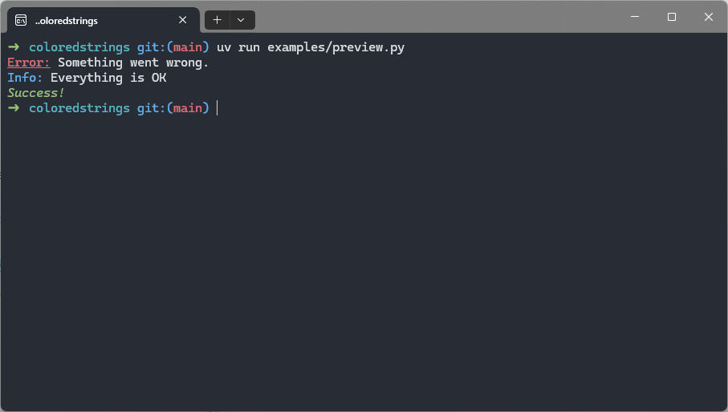

# coloredstrings

[](https://github.com/samedit66/coloredstrings/actions/workflows/ci-and-publish.yml)
[](https://pypi.org/project/coloredstrings/)
[](https://pypi.org/project/coloredstrings/)
[](LICENSE)

Build terminal styles in Python and call them to get a string. The package supports Python 3.9 and later and has no runtime dependencies.

```python
import coloredstrings as cs

error = cs.bold.red
print(error("Error"), "Could not open the file")
print(cs.white.on.blue(" INFO "), "Configuration loaded")
```



## Installation

```sh
python -m pip install coloredstrings
python -m coloredstrings
```

The second command runs a demo in your terminal. To try the development version, install with `python -m pip install git+https://github.com/samedit66/coloredstrings.git`.

## Compose and reuse styles

Each step returns a new style. You can save a chain, extend it, or import a style directly. Calling a style converts its arguments to strings and joins them with a space. Set `sep` to choose a different separator.

```python
from coloredstrings import blue

label = blue.bold
print(label("Job", 42, sep="#"))
print(blue("The job is running"))
```

Use `.on` to apply the next color to the background. If you set the foreground or background more than once, the last color for that part wins. Attributes such as bold and underline can be combined. To style a word inside a longer message, use an f-string. The outer color resumes after the word.

```python
import coloredstrings as cs

print(cs.yellow(f"Retrying {cs.bold.red('upload')} in five seconds"))
print(cs.on.blue.white.underline("Download"))
```

## Colors and attributes

| Color | Example |
| --- | --- |
| Terminal palette | `cs.red`, `cs.bright_red`, `cs.on.blue` |
| 256-color palette | `cs.color256(37)`, `cs.on.color256(240)` |
| RGB components or tuple | `cs.rgb(64, 128, 255)`, `cs.rgb((64, 128, 255))` |
| Hex string | `cs.rgb("#4080ff")`, `cs.on.rgb("#fc0")` |
| Named RGB color | `cs.rgb("coral")`, `cs.coral` |

The eight base colors are `black`, `red`, `green`, `yellow`, `blue`, `magenta`, `cyan`, and `white`. Each has a `bright_` variant. Both `gray` and `grey` select `bright_black`. Palette colors follow the terminal theme. For a specific RGB value, use `rgb`. For example, `cs.red` uses the terminal's red and `cs.rgb("red")` requests CSS red.

| Effect | Attributes |
| --- | --- |
| Weight and emphasis | `bold`, `dim` (also `faint` or `dark`), `italic` |
| Lines | `underline`, `double_underline`, `overline`, `strike` (also `strikethrough`) |
| Display | `inverse` (also `reverse`), `hidden` (also `concealed`) |
| Terminal-dependent effects | `blink` (also `slow_blink`), `rapid_blink`, `framed`, `encircle` (also `circle`) |

`cs.visible("◆ ")` produces an empty string when colors are disabled. Use it for optional decoration. `cs.reset()` emits a reset sequence when colors are enabled.

## Define a theme

Use `extend` to name styles for your application. Pass keyword arguments or a dictionary. Values can be named or hex colors, RGB tuples, or existing styles. Theme styles combine with the current chain and use its color mode.

```python
import coloredstrings as cs

theme = cs.extend(success=cs.green, warning="#ffa500", detail=(150, 150, 150))
print(theme.bold.success("Saved"))
print(theme.warning("Disk space is low"))
print(theme.color_mode(cs.ColorMode.NO_COLOR).success("Saved"))
```

## Color modes and output streams

By default, the module selects a mode for standard output at import time. It considers command-line flags, environment variables, the platform, and the terminal. RGB colors fall back to 256 or 16 colors according to the selected mode.

| Setting, in order of precedence | Effect |
| --- | --- |
| `--no-color`, `--color` | Disable colors or select 16 colors. If both are present, `--no-color` wins. |
| `FORCE_COLOR` | `0` disables colors. `1`, `2`, and `3` select 16 colors, 256 colors, and truecolor. An empty value or `true` selects 16 colors. `false` disables colors. |
| `NO_COLOR` | A nonempty value disables colors. |
| `CLICOLOR_FORCE` | Accepts the same values as `FORCE_COLOR`. |
| `CLICOLOR` | A nonempty value selects 16 colors on a terminal and disables colors for a redirected stream. |

Use `color_mode` to set a mode for a chain, or pass `mode=` for one call. For a different output stream, detect its mode explicitly.

```python
import sys

import coloredstrings as cs
from coloredstrings.color_support import detect_color_support

errors = cs.color_mode(detect_color_support(sys.stderr))
print(errors.red("Could not open the file"), file=sys.stderr)
assert cs.red("Ready", mode=cs.ColorMode.NO_COLOR) == "Ready"
```

The available modes are `NO_COLOR`, `ANSI_16`, `EXTENDED_256`, and `TRUE_COLOR` on `cs.ColorMode`.

## Links and plain text

Use `link(url)` to make a caption clickable in terminals that support OSC 8 hyperlinks. Use `strip_ansi` to keep the visible text for a plain-text destination.

```python
import coloredstrings as cs

docs = cs.blue.underline.link("https://docs.python.org/")("Python documentation")
print(docs)
assert cs.strip_ansi(docs) == "Python documentation"
```

## Logging

Attach `ColoredFormatter` to a standard logging handler. By default, it colors the level name. Set `colorize_msg=True` to color the message too, or `colorize_level=False` to leave the level name plain. Other handlers can format the same record independently.

```python
import logging

from coloredstrings.logger import ColoredFormatter

console = logging.StreamHandler()
console.setFormatter(ColoredFormatter("%(levelname)s %(message)s"))
logger = logging.getLogger("example")
logger.addHandler(console)
logger.warning("Retrying job %s", 42)
```

The formatter uses the color mode detected for standard output when its module is imported.

## Contributing

Install the development dependencies with `uv sync --frozen`. Run `uv run pytest`, `uv run ruff check .`, and `uv run mypy` before submitting a change. Include a regression test when fixing output or color detection.
