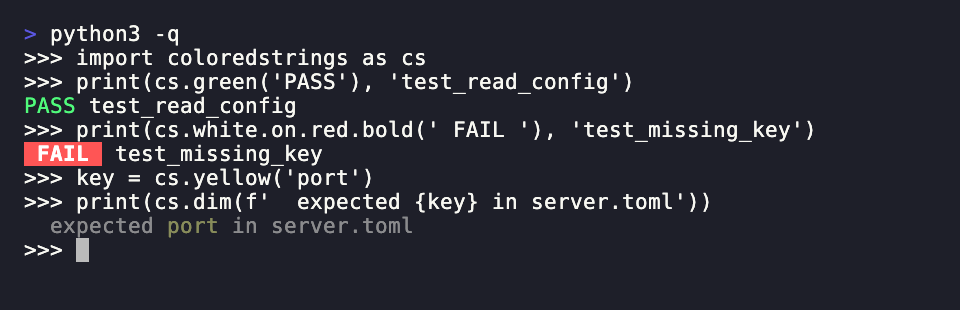

# coloredstrings

[](https://github.com/samedit66/coloredstrings/actions/workflows/ci-and-publish.yml)
[](https://pepy.tech/projects/coloredstrings)
[](https://pypi.org/project/coloredstrings)
[](https://pypi.org/project/coloredstrings)
[](https://github.com/samedit66/coloredstrings/blob/main/LICENSE)
[](https://github.com/astral-sh/ruff)
[](https://mypy-lang.org/)

`cs.white.on.red(" FAIL ")` reads about the way it looks. Give that style a name and you can use it anywhere your Python program builds a string.

```python
import coloredstrings as cs

passed = cs.green("PASS")
failed = cs.white.on.red.bold(" FAIL ")

print(passed, "test_read_config")
print(failed, "test_missing_key")
print(cs.dim(f"  expected {cs.yellow('port')} in server.toml"))
```



## What you get

- **Styles you can keep.** Save `warning = cs.yellow`, then use `warning.bold` for the heading and `warning` for the rest.
- **Nested colors.** In the example above, `port` is yellow. You can also put a red word inside a blue sentence, and the rest of the sentence picks up the outer blue again.
- **16 colors, 256 colors, and truecolor.** Use the terminal palette, a hex value, or a name like `coral`. On terminals with fewer colors, coloredstrings picks a fallback.
- **Plain text when you need it.** Respect `--no-color` at the command line, force a mode in a test, or strip the styling from a string you already have.
- Named themes, clickable links, and a formatter for Python’s `logging` module. No runtime dependencies.

## Install it and see the colors

**We recommend uv.** From your project directory, add coloredstrings and run the terminal sampler.

```sh
uv add coloredstrings
uv run python -m coloredstrings
```

**With pip**, run these commands in your virtual environment.

```sh
python -m pip install coloredstrings
python -m coloredstrings
```

The sampler shows what your terminal theme does with `bright_black` and whether it draws a double underline. Requires Python 3.11 or later.

## Working with styles

### Foreground, background, and emphasis

Start with a color or an attribute. Use `.on` when you want the next color to paint the background.

```python
import coloredstrings as cs

print(cs.red("deleted"))
print(cs.black.on.yellow(" modified "))
print(cs.on.blue.white.bold(" selected "))
```

Foreground and background are independent. In `cs.on.blue.white`, blue goes behind the text and white goes in front. If you set the same part twice, the last color wins.

Calling a style works much like `print`. It converts its arguments to strings and joins them with a space. You get the resulting string back, so you decide where it goes.

```python
from coloredstrings import cyan

issue = cyan("issue", 42, sep="#")
print(f"Changes requested on {issue}")
```

### Choosing a color

| If you have… | Write |
| --- | --- |
| A terminal color | `cs.red`, `cs.bright_red`, `cs.on.red` |
| A palette index | `cs.color256(208)`, `cs.on.color256(235)` |
| An RGB value | `cs.rgb(255, 127, 80)` or `cs.rgb((255, 127, 80))` |
| A hex value | `cs.rgb("#ff7f50")` or `cs.rgb("#fc0")` |
| A named color | `cs.coral` or `cs.rgb("coral")` |

The eight base colors are `black`, `red`, `green`, `yellow`, `blue`, `magenta`, `cyan`, and `white`. Each has a `bright_` variant. Both `gray` and `grey` select `bright_black`.

There’s a reason to keep both `cs.red` and `cs.rgb("red")` around. The first uses the red from the reader’s terminal theme. The second asks for `#ff0000`. Use the former for a conventional error message and the latter when the shade itself matters.

In 3.4, RGB components and palette indices accept integers from `0` to `255` inclusive. An out-of-range value raises `ValueError` when you build the style, even with colors disabled. Floats and booleans raise `TypeError`. An RGB tuple takes exactly three components.

> **Warning:** Mixing conflicting attributes such as `.underline.double_underline` or `.blink.rapid_blink` has no defined precedence. Their output order may vary between processes. Choose one variant per chain or theme composition.

### Text attributes

| Effect | Names |
| --- | --- |
| Weight and emphasis | `bold`, `dim` (also `faint`, `dark`), `italic` |
| Lines | `underline`, `double_underline`, `overline`, `strike` (also `strikethrough`) |
| Inversion and concealment | `inverse` (also `reverse`), `hidden` (also `concealed`) |
| Other terminal effects | `blink` (also `slow_blink`), `rapid_blink`, `framed`, `encircle` (also `circle`) |

Two helpers are worth calling out. `cs.reset()` emits an ANSI reset when styling is enabled. `cs.visible("● ")` gives you a decorative marker that disappears entirely when colors are off. Terminal support varies for effects such as blink and framing.

### Give your application its own vocabulary

For a single reusable style, an assignment is enough. When several commands share a palette, `extend()` lets you name styles after what they mean in your application.

```python
import coloredstrings as cs

diff = cs.extend(added=cs.green, removed=cs.red, hunk="#8a72d6")

print(diff.hunk("@@ -1 +1 @@"))
print(diff.removed("- timeout = 3"))
print(diff.added("+ timeout = 10"))
```

Theme entries can be styles, color names, hex strings, or RGB tuples. `extend()` accepts a dictionary as well as keyword arguments. You can still write `diff.bold.added`, and `diff.color_mode(cs.ColorMode.NO_COLOR)` gives you a plain-text version of the whole theme.

> **Warning:** Theme names matching built-in fields or methods (for example `red` or `rgb`) are inaccessible through attribute lookup. Do not mutate `extensions` or an `extensions=` dictionary after creating a builder: derived styles may share it.

### Terminal links and plain text

A terminal that supports OSC 8 hyperlinks can make an issue number clickable. The same label can go into a plain-text report.

```python
import coloredstrings as cs

issue = cs.underline.link("https://github.com/samedit66/coloredstrings/issues")("issues")
print(f"Report a bug under {issue}.")
assert cs.strip_ansi(issue) == "issues"
```

### Color in the console, plain text in the log

Attach `ColoredFormatter` to the handler that writes to the terminal. By default it colors the level name. Set `colorize_msg=True` to color the message as well, or `colorize_level=False` to leave the level name alone.

```python
import logging

from coloredstrings.logger import ColoredFormatter

console = logging.StreamHandler()
console.setFormatter(ColoredFormatter("%(levelname)s  %(message)s"))

log = logging.getLogger("backup")
log.addHandler(console)
log.warning("Skipping locked file %s", "index.db")
```

A file handler attached to the same logger receives the original record, including its message template and arguments. The formatter uses the color mode detected for standard output when its module is imported unless you pass `mode=`. When stdout is redirected but the handler writes to stderr, choose the mode explicitly:

```python
import sys
from coloredstrings.color_support import detect_color_support

console.setFormatter(ColoredFormatter(
    "%(levelname)s  %(message)s",
    mode=detect_color_support(sys.stderr),
))
```

> **Warning:** A formatter does not infer the destination of its handler. Sharing one formatter between a terminal handler and a file handler also shares its color mode; use separate formatters with explicit modes.

> **Warning:** Nested styling restores the standalone reset codes emitted by coloredstrings. External strings containing combined resets such as `\x1b[0;1m` or `\x1b[39;1m` can interrupt the outer style. This is not a general-purpose ANSI parser.

### Who decides whether to use color?

By default, coloredstrings checks standard output at import time. For a command-line program, the overrides below take precedence in the order shown.

| Setting | Effect |
| --- | --- |
| `--no-color`, `--color` | Disable styling or select 16 colors. `--no-color` wins if both are present. |
| `FORCE_COLOR` | `0` disables styling, `1` selects 16 colors, `2` selects 256, and `3` selects truecolor. An empty value or `true` selects 16 colors. `false` disables styling. |
| `NO_COLOR` | A nonempty value disables styling. |
| `CLICOLOR_FORCE` | Takes the same values as `FORCE_COLOR`. |
| `CLICOLOR` | A nonempty value selects 16 colors on a terminal and plain text on a redirected stream. |

If you know the destination, you can choose the mode yourself. This is particularly useful when a command writes data to stdout and diagnostics to stderr.

```python
import sys

import coloredstrings as cs

errors = cs.StyleBuilder.for_stream(sys.stderr)
print(errors.red("Permission denied"), file=sys.stderr)
```

> **Warning:** `for_stream()` detects the mode when the builder is created. Recreate it if the destination changes. Module-level styles still capture stdout's mode at import time; combining them with later redirection or stderr output can select the wrong mode. Color detection on Windows does not enable VT processing; a console with VT disabled may display escape sequences despite detecting truecolor.

Use `color_mode()` for a chain or `mode=` for one call. The available modes are `NO_COLOR`, `ANSI_16`, `EXTENDED_256`, and `TRUE_COLOR` on `cs.ColorMode`. For example, a test can assert `cs.red("failed", mode=cs.ColorMode.NO_COLOR) == "failed"` on any machine.

## Coming from another library?

Here’s how each library spells the same small job: a white `FAIL` label on a red background.

| Library | What you’d write |
| --- | --- |
| **coloredstrings** | `cs.white.on.red(" FAIL ")` |
| [ansis](https://github.com/webdiscus/ansis#usage) · JavaScript | ``white.bgRed` FAIL ` `` |
| [yachalk](https://github.com/bluenote10/yachalk#usage) · Python | `chalk.white.bg_red(" FAIL ")` |
| [termcolor](https://github.com/termcolor/termcolor#example) · Python | `colored(" FAIL ", "white", "on_red")` |
| [Colorama](https://github.com/tartley/colorama#colored-output) · Python | `Fore.WHITE + Back.RED + " FAIL " + Style.RESET_ALL` |
| [Rich](https://github.com/Textualize/rich#using-the-console) · Python | `console.print(" FAIL ", style="white on red")` |

If you use **ansis** or **yachalk**, chains and nested expressions will feel familiar. The spelling to remember here is `.on`: it works with `.red`, `.color256(208)`, and `.rgb("#ff7f50")` alike. **termcolor** also accepts RGB tuples. In coloredstrings you can give that RGB style a name, add `.bold` where needed, and use it throughout a command.

## How the chain works

`cs.red` is a callable `StyleBuilder`. Adding `.bold` creates a new builder. The original is still useful, which matters when two messages share a color but only one of them needs emphasis.

```python
import coloredstrings as cs

filename = cs.cyan
current_file = filename.bold

print(filename("defaults.toml"))
print(current_file("local.toml"))
print(filename("overrides.toml"))
```

The ANSI codes are assembled when you call the style. The builder opens the foreground, background, and attributes around your text, then closes them in reverse order. With nested colors, it restores the outer color after the inner one closes. Across a line break, it closes and reopens the style so a background stays with its line. [StyleBuilder](https://github.com/samedit66/coloredstrings/blob/dev/src/coloredstrings/style_builder.py) · [ANSI rendering](https://github.com/samedit66/coloredstrings/blob/dev/src/coloredstrings/stylize.py)

Working on a rendering bug? Include the smallest expression that shows it and the color mode you used. `repr(result)` makes a reset code much easier to spot in an issue. To run the suite locally, use `uv sync --frozen` followed by `make check` (lint, formatting, type checks, and tests). [Report an issue](https://github.com/samedit66/coloredstrings/issues)
